# Aussterben für immer: Unterarten, Urbäume und das R.I.P.-Bild

Stand: 20. 10. 2026 · Code: `src/stagefates.ts` (neu), `src/lycopsids.ts`, Anzeige in `src/tree.ts`,
`src/speciesstrip.ts`, `src/speciesinfo.ts`, `src/specieslineage.ts`, `src/lexicon.ts`, `src/notify.ts`

## Auftrag

1. Auf der Baumkarte „Ausgestorben“ statt „Für immer ausgestorben“, damit der Text passt.
2. Das R.I.P.-Bild für alle Unterarten verwenden, die für immer aussterben: ausgegraut, mit R.I.P.
3. Prüfen, welche Unterarten logisch aussterben (etwa die Urzellen, die verdrängt werden), ebenso die
   Urbäume. Dazu eine kurze Meldung mit passendem R.I.P.-Bild.
4. Nachtrag: Auch die Unterarten-Leiste im Evolutionsbaum zeigt R.I.P., und ein Klick auf ein Bild
   öffnet die Art im Arten-Lexikon.

Alles umgesetzt.

## Wie eine Unterart ausstirbt

Jede Unterart, deren Form auf der Erde ausgestorben ist, nennt eine spätere Unterart ihrer Gruppe als
Nachfolger. Halten der Nachfolger und die Unterarten nach ihm zusammen **24 Felder**
(`STAGE_SUCCESSOR_TILES`, so viel wie „verbreitet“ im Baum), stirbt die ältere für immer aus:

- Ihre Populationen gehen an den Nachfolger, es bleiben keine Lücken auf der Karte.
- Der Aufstieg überspringt sie, neue Populationen (Ausbreitung, Ansiedeln) beginnen hinter ihr.
- Das Lexikon führt sie sofort als ausgestorben, ohne die übliche Wartezeit.
- Eine kurze Meldung erscheint mit ihrem Porträt unter dem R.I.P.-Band.

Es entscheidet nur die Ausbreitung des Nachfolgers, kein Erddatum. Wann es passiert, hängt also vom
Planeten ab.

### Die 37 Unterarten

| Gruppe | Stirbt aus | Nachfolger |
|---|---|---|
| Erste Zellen | Urzellen | Archaeen |
| Schwämme & Nesseltiere | Ediacara-Wedel, Dickinsonien | Becherschwämme |
| | Becherschwämme | Runzelkorallen |
| | Runzelkorallen | Steinkorallen |
| Frühe Zweiseitentiere | Urwürmer, Kalkröhrchen | Priapswürmer |
| Gliederfüßer des Meeres | Anomalocariden | Seeskorpione |
| | Trilobiten, Seeskorpione | Zehnfußkrebse |
| Weichtiere | Urschnecken | Käferschnecken |
| | Orthoceren | Ammoniten |
| Fische | Kopfschildfische, Panzerfische | Haie |
| Wale | Urwale, Wandelwale, Paddelwale, Basilosaurier | Bartenwale |
| Insekten | Urflügler, Riesenlibellen | Käfer |
| Amphibien | Tiktaalik → Ichthyostega → Panzerlurche | jeweils die nächste |
| | Panzerlurche | Frösche |
| | Diplocaulus | Salamander |
| Reptilien | Ursaurier, Pareiasaurier, Gleitechsen | Schildkröten |
| Dinosaurier | Urdinosaurier → Plateosaurier | jeweils die nächste (bis Sauropoden) |
| | Kammsaurier | Megalosaurier |
| Vögel | Archaeopteryx → Konfuziusvögel | jeweils die nächste (bis Zahnvögel) |
| Säugetiere | Ursäuger, Gleitsäuger | Beuteltiere |
| Huftiere & Weidetiere | Urpferde | Pferde |
| | Brontotherien | Riesennashörner |
| | Riesennashörner | Antilopen |

Dazu kommen wie bisher die Opfer des Kometen: alle Dinosaurier, Flugsaurier, Ammoniten, Belemniten
und Zahnvögel. Sie tragen jetzt dasselbe R.I.P.-Bild.

**Bewusst nicht ausgestorben**, weil es heute lebende Vertreter gibt: Vasenamöben (Schalenamöben),
Stummelfüßer (Samtwürmer), Stachelzysten (Dauerstadien heutiger Einzeller), Kieferlose Fische
(Neunaugen, Schleimaale), Kloakentiere, Pfeilschwanzkrebse. Die letzte Unterart einer Gruppe stirbt nie
auf diese Weise aus (Nummuliten), weil sie keinen Nachfolger hat. Die wissenschaftliche Einordnung steht
als Prüfpunkt 22 im Quellenbericht. Viele der Gruppen endeten auf der Erde in Massenaussterben, nicht
durch Verdrängung. Die Spieltexte sagen deshalb „Abgelöst durch …“.

## Urbäume und Frühe Gefäßpflanzen

Beide folgen jetzt dem Muster der Schuppenbäume (`FLORA_DISPLACEMENT`):

1. Solange nicht alle Tochtergruppen im Baum entstanden sind, passiert nichts. So wird keine Linie
   abgeschnitten.
2. Danach werden sie dort zurückgedrängt, wo ihre Rivalen wachsen:
   - **Frühe Gefäßpflanzen** durch Farne, Bärlappe und Urbäume,
   - **Urbäume** durch Samenpflanzen, Nadel- und Laubbäume.
3. Führen die Rivalen 10 % des Landes (`FLORA_GONE_SHARE`), sterben sie für immer aus. Die
   Restbestände sterben ab, das Werkzeug „Pflanzen“ lehnt sie ab („für immer ausgestorben – abgelöst
   durch …“), und die Baumkarte zeigt „Ausgestorben“ mit R.I.P.

Die Meldung zum Aussterben kommt einmal, mit R.I.P.-Bild. Die sonst übliche Karte „ausgestorben –
neu ansiedeln“ entfällt für sie, sie wäre falsch.

**Bewusst nicht:**
- Erste Landpflanzen (ähnlich heutigen Lebermoosen).
- Der Knoten „Samenpflanzen“. Er steht zwar für die ausgestorbenen Samenfarne, heißt aber
  „Samenpflanzen“, und Nadel- und Blütenpflanzen sind auch Samenpflanzen. „Samenpflanzen
  ausgestorben“ würde falsch klingen. Falls gewünscht: Knoten in „Samenfarne“ umbenennen und in die
  Tabelle aufnehmen.

## So sieht es aus

Evolutionsbaum: Frühe Gefäßpflanzen und Urbäume mit „Ausgestorben“ und R.I.P., der Text passt in die
Karte.

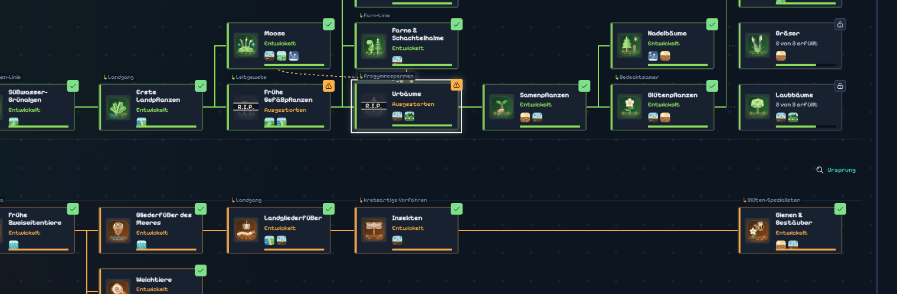

Unterarten-Leiste im Detailbereich des Baums: Urzellen grau mit R.I.P. Jedes Bild ist jetzt ein
Knopf. Ein Klick öffnet die Art im Arten-Lexikon (hier: Klick auf Urzellen).

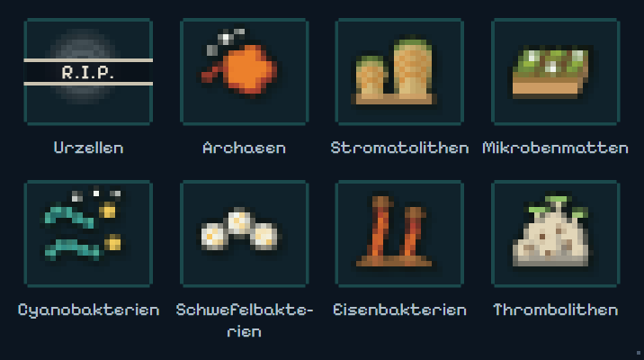

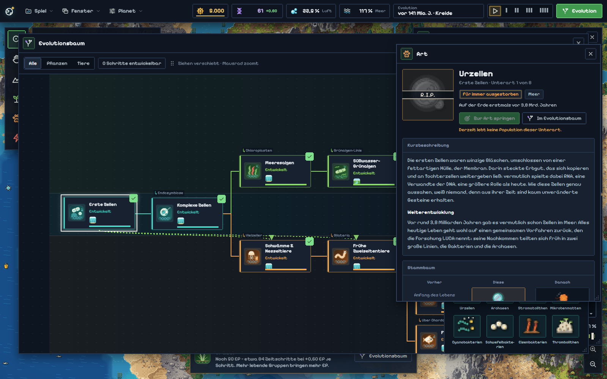

Arten-Lexikon: ausgegraut, R.I.P.-Band, darunter kurz „ausgestorben“.

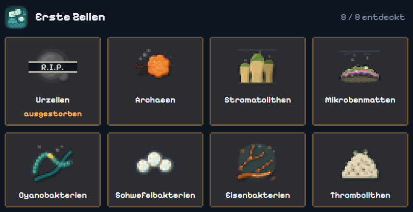
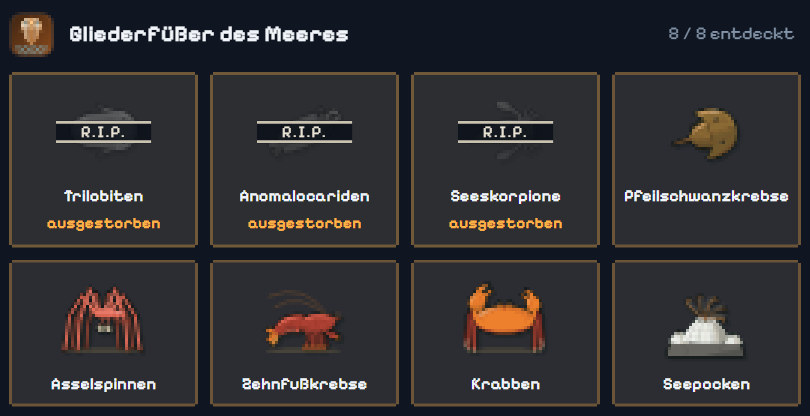
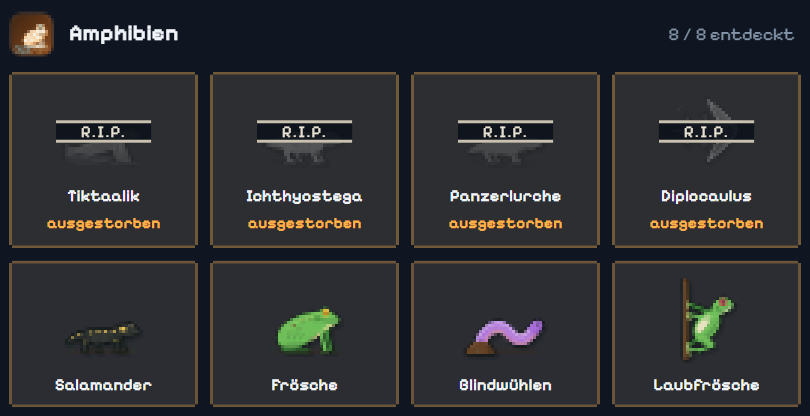

Info-Box der Art („für immer ausgestorben“; der Abschnitt „Warum sie entstanden ist“ nennt den
Nachfolger) und ihr Stammbaum:

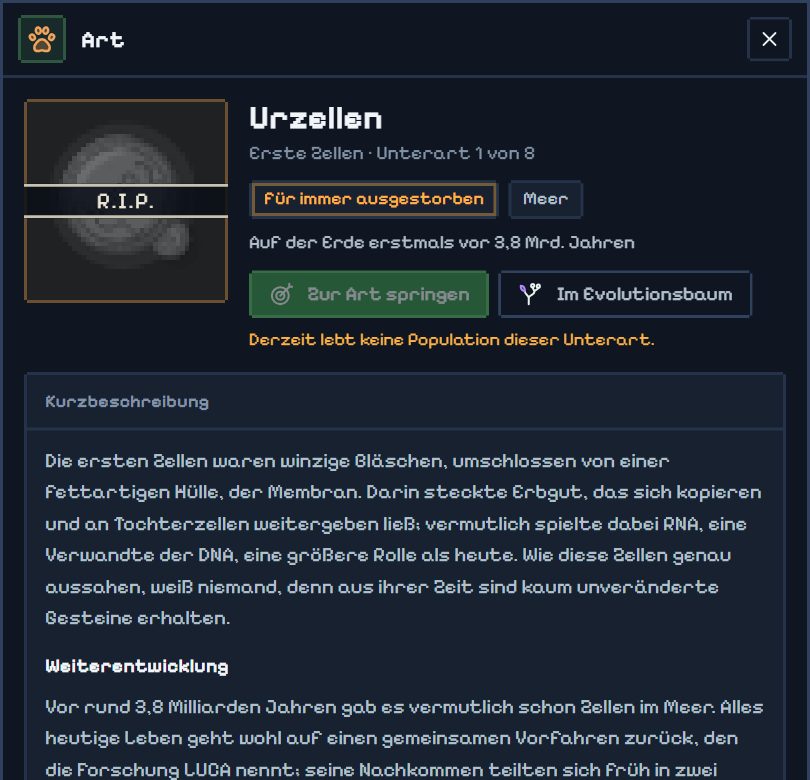
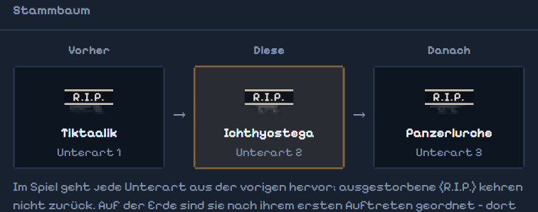

Meldung: kurze Karte mit dem Porträt der Unterart bzw. dem Bild der Pflanzengruppe unter dem
R.I.P.-Band. Die Chronik zeigt dasselbe Bild.

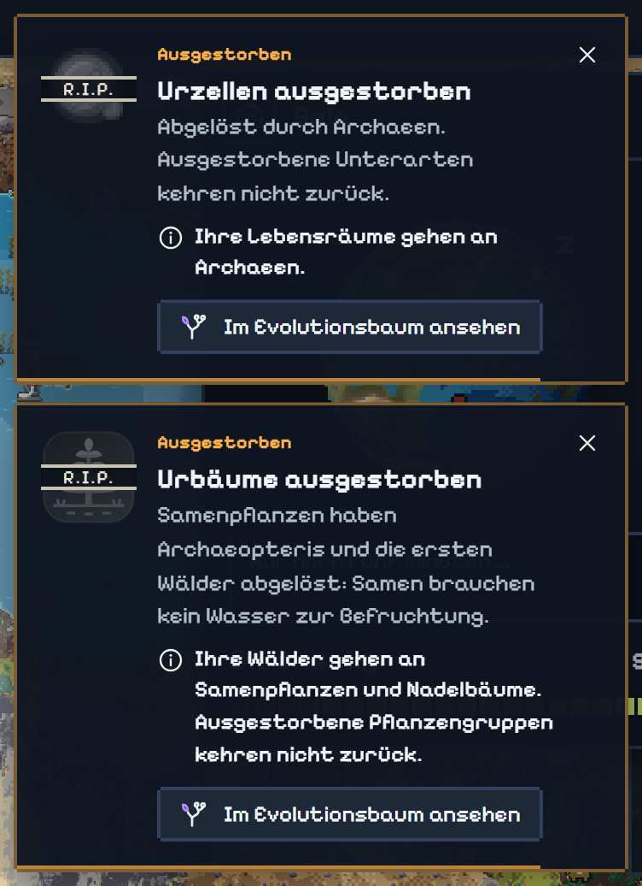
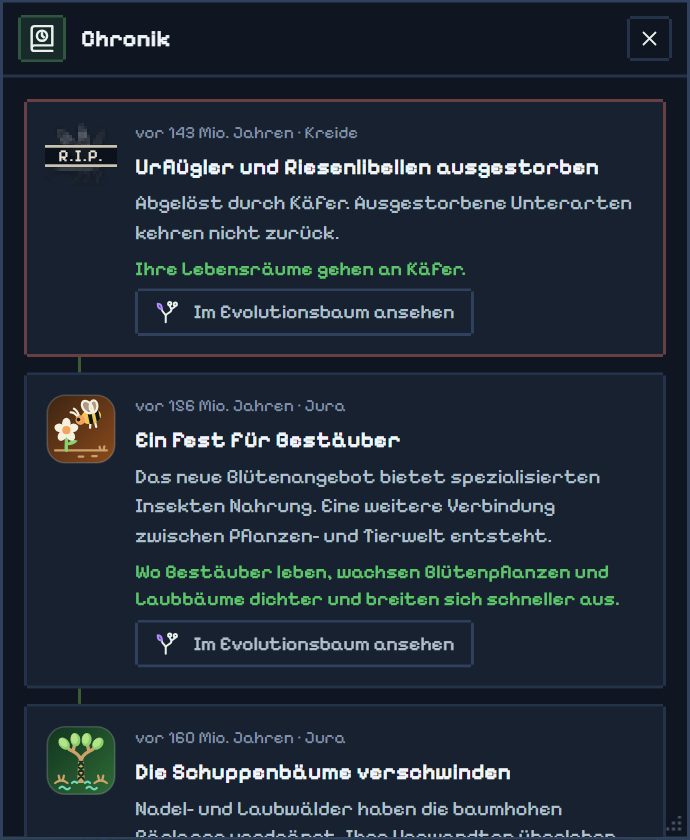

## Der R.I.P.-Stempel (Nachtrag 21. 10. 2026)

Trifft ein Spieler zum allerersten Mal auf eine ausgestorbene Unterart oder Art, läuft einmal eine
Animation in der Mitte des Bildschirms (`src/ripstamp.ts`, `css/ripstamp.css`):

1. Das Bild (Lexikon-Porträt der Unterart bzw. Baum-Bild der Art) erscheint in Farbe, darunter Name,
   Gruppe und „für immer ausgestorben“.
2. 0,8 s halten.
3. Das R.I.P.-Band (dasselbe wie auf den Symbolen) fliegt sechsfach vergrößert und schräg von oben ein
   und schrumpft in 0,3 s auf seine Endgröße, mit `swipe.mp3`. Dessen Rauschen erreicht seine Spitze
   243 ms nach Dateibeginn, also kurz vor dem Aufprall.
4. Aufprall: `hit-sfx.mp3` startet genau jetzt, ab 0,05 s, denn die ersten 54 ms der Datei sind still
   (aus den Samples gemessen). Das Band staucht sich (zu flach, zu schmal, zurück), bleibt 7° schräg,
   die Karte wackelt kurz.
5. Gleichzeitig wird das Bild grau (Sättigung auf 0, etwas dunkler).
6. 1,1 s stehen lassen, dann in 0,4 s ausblenden; der Nachhall des Stempels wird mit ausgeblendet.

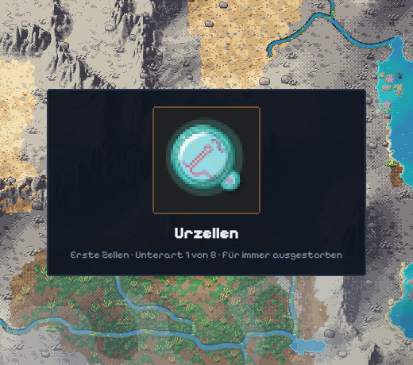
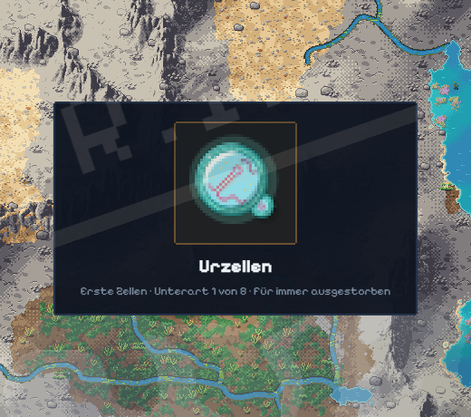
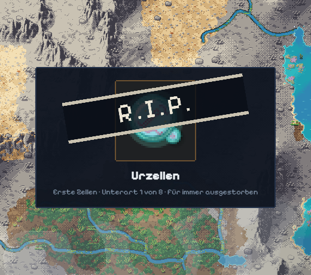
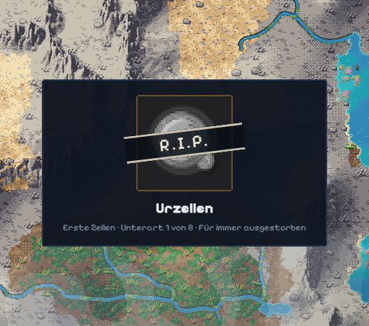
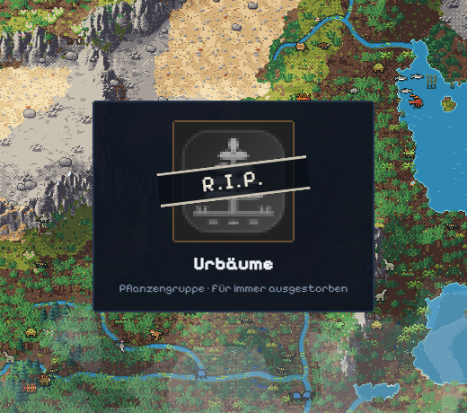

Regeln:
- **Auslöser ist dieselbe Prüfung, die das R.I.P.-Zeichen auf den Symbolen steuert**:
  `faunaStatus` → `is-gone` für entdeckte Unterarten, `stepGoneReason` (Baumkarte) für Arten. Eine
  zweite Aussterbe-Liste gibt es nicht. Unentdeckte Unterarten bekommen keinen Stempel, sie tragen auch
  kein R.I.P.-Zeichen.
- **Einmal pro Spieler:** Welche Stempel schon liefen, steht im `localStorage` (`simearth2.ripSeen`),
  über Planeten und Sitzungen hinweg. Danach bleibt nur das bekannte R.I.P.-Zeichen. Zum erneuten
  Testen in der Browser-Konsole: `localStorage.removeItem('simearth2.ripSeen')`, dann neu laden.
- **Warteschlange:** Mehrere Stempel laufen nacheinander, nie übereinander (gemessen: 3,4 s je Stempel).
  Sie warten, solange Titel, Intro, ein Film oder Meilenstein, ein Dialog, die Dinosaurier-Frage oder
  der Raketenfilm den Bildschirm belegen, und bei verstecktem Tab.
- **Blockiert nichts:** Die Ebene nimmt keine Klicks an, das Spiel läuft weiter.
- **Effekte reduzieren** (Einstellung): Das Band erscheint ohne Anflug und Wackeln, der Rest bleibt.
- Ein geladener Spielstand mit schon ausgestorbenen Arten zeigt deren Stempel beim ersten Laden, einmal.
  Nach dem Kometen können das viele sein: alle entdeckten Dinosaurier-Unterarten, die Art selbst und
  Flugsaurier, Ammoniten, Belemniten, Zahnvögel, also gut 40 s Stempel hintereinander.
- Lautstärke: `swipe` 0,6 und `hit-sfx` 0,8 der Effektlautstärke (`SFX_LEVELS` in `src/music.ts`),
  noch nicht nach Gehör abgestimmt.

## Ablauf auf einem Probeplaneten

Seed 12345, gieriger Spieler (entwickelt immer den billigsten Schritt), 4000 Ticks, ohne Komet:

| Tick | Erdkalender | Meldung |
|---:|---|---|
| 38 | vor 3,72 Mrd. Jahren | Urzellen ausgestorben |
| 814 | vor 520 Mio. Jahren | Ediacara-Wedel und Dickinsonien ausgestorben |
| 1076 | vor 488 Mio. Jahren | Becherschwämme ausgestorben |
| 1079 | vor 487 Mio. Jahren | Runzelkorallen ausgestorben |
| 1133 | vor 481 Mio. Jahren | Urwürmer und Kalkröhrchen ausgestorben |
| 1262 | vor 464 Mio. Jahren | Anomalocariden ausgestorben |
| 1392 | vor 448 Mio. Jahren | Urschnecken ausgestorben |
| 1486 | vor 436 Mio. Jahren | Orthoceren ausgestorben |
| 1640 | vor 417 Mio. Jahren | Trilobiten und Seeskorpione ausgestorben |
| 1949 | vor 379 Mio. Jahren | Kopfschildfische und Panzerfische ausgestorben |
| 2487 | vor 311 Mio. Jahren | Tiktaalik ausgestorben |
| 2524 | vor 307 Mio. Jahren | Ichthyostega ausgestorben |
| 2541 | vor 305 Mio. Jahren | Frühe Gefäßpflanzen ausgestorben |
| 2750 | vor 278 Mio. Jahren | Diplocaulus ausgestorben |
| 2842 | vor 267 Mio. Jahren | Panzerlurche ausgestorben |
| 3342 | vor 195 Mio. Jahren | Urflügler und Riesenlibellen ausgestorben |
| 3505 | vor 170 Mio. Jahren | Ursaurier, Pareiasaurier und Gleitechsen ausgestorben |
| 3577 | vor 160 Mio. Jahren | Urbäume ausgestorben |

Mehrere Unterarten, die gleichzeitig enden, teilen sich eine Meldung. Die übrigen (Wale, Vögel,
Säugetiere, Huftiere, Dinosaurier) folgen später, sobald diese Gruppen weit genug sind.

Auffällig:
- Die **Urzellen** sterben sehr früh, weil sich die Archaeen schnell ausbreiten. Das ist gewollt
  („verdrängt“), aber ein Stellknopf, falls es zu schnell wirkt (`STAGE_SUCCESSOR_TILES`).
- Die **Runzelkorallen** enden drei Ticks nach den Becherschwämmen, weil die Steinkorallen im Spiel
  schon verbreitet sind, wenn die Runzelkorallen ankommen. Die Unterarten-Leiter des Spiels ist
  schneller als die Erdgeschichte.

## Speicherstände

Neues optionales Feld `fates` (welche Unterarten und Pflanzengruppen ausgestorben sind). Das
Speicherformat bleibt gleich. Ein älterer Spielstand ohne das Feld holt das Aussterben im ersten Tick
nach, ohne Meldungsflut: Die Einträge landen in der Chronik, die Karten erscheinen nicht.

## Tests

- Neu: `tests/fates.test.js` (in `npm run test:quick`), 4 Tests:
  - Urzellen enden genau ab 24 Feldern und geben ihre Felder an die Archaeen ab, einmal.
  - Neue Populationen beginnen hinter dem Ausgestorbenen, und das Lexikon meldet es sofort.
  - Urbäume enden erst nach den Samenpflanzen und bei 10 %; das Pflanzen-Werkzeug lehnt sie ab.
  - Der Spielstand behält alles, und ein alter Stand holt es still nach.
- Angepasst:
  - `tests/lycopsids.test.js`: neuer Funktionsname `updateFloraEras`.
  - `tests/sim.test.js` „the planet greens from the shore inward“ läuft jetzt auf Seed 3 statt 12345.
    Grund: Die neue Regel verschiebt den Zufallsverlauf. Auf Seed 12345 entwickelte der gierige Spieler
    die Landpflanzen danach an einem Ort mit nur 2 passenden Feldern. Ein Vergleichs-Build ohne die neue
    Regel scheitert an diesem Test auf Seed 1 und 2 genauso, der Test hängt also am Seed, nicht an der
    Mechanik.
  - `tests/faunadex.test.js` (2 Tests) und `tests/save.test.js` (1 Test): Sie nahmen an, dass es
    nach 80 bis 300 Ticks noch Urzellen gibt. Jetzt nutzen sie eine lebende Unterart.
- Dabei gefunden und im Code behoben: Alte Spielstände ohne Liste der ausgestorbenen Gruppen leiten
  sie aus den Chronik-Meldungen ab. Eine Meldung über eine einzelne Unterart (Urzellen) hätte dort
  die ganze Gruppe „Erste Zellen“ als ausgestorben markiert. Solche Meldungen zählen jetzt nicht mehr
  (`src/save.ts`).
- Ergebnisse:
  - `npm run typecheck`: fehlerfrei.
  - `npm run test:quick` auf dem finalen Build: alles grün.
  - Volle Suite (alle Testdateien): bis auf die drei oben genannten Tests grün. Diese drei laufen nach
    der Anpassung ebenfalls grün, zusammen mit `fates.test.js` (20 von 20).

## Einschränkungen

- Geprüft nur in headless Chrome. Andere Browser und Sound: nicht geprüft.
- Neue CSS-Regeln (R.I.P.-Band, klickbare Unterarten-Leiste): Nach dem Update im Browser
  **Strg+F5** drücken, sonst passt das alte CSS nicht.
- Der ältere, nie übernommene Worktree `earthsim-extinction` (Branch `feat/extinction`) enthält eine
  größere Variante dieser Idee. Übernommen wurden daraus nur die Pflanzen-Verdrängung und die Idee der
  Nachfolger, nicht das dort umgebaute Entstehen der Unterarten und nicht die „Großkrise“, weil der
  Komet das inzwischen übernimmt. Der Worktree kann aufgeräumt werden.
