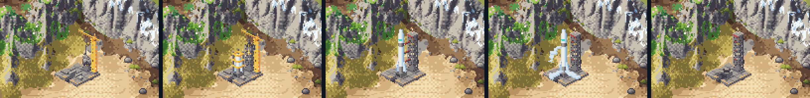
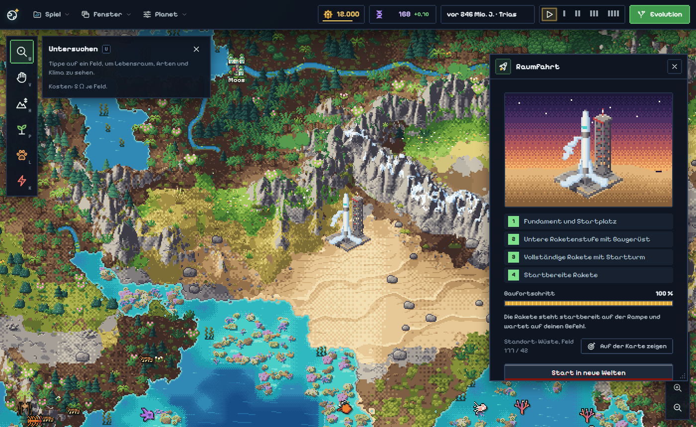
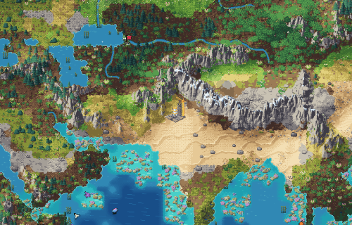
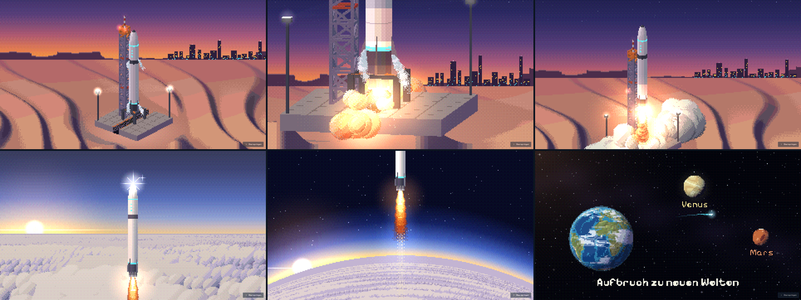

# Raumfahrtprojekt: Start in neue Welten

Stand: 20. 10. 2026.

## 1. Ablauf für den Spieler

1. Die erste bewohnte Stadt erreicht das Nanotech-Zeitalter. Im nächsten Zeitschritt beginnt das Raumfahrtprojekt.
   Die Chronik und eine große Meilensteinkarte melden „Aufbruch ins All“. Das gilt einmal pro Planet und für jede
   intelligente Art: Hominiden, Insekten, Vögel, Dinosaurier usw.
2. In einer Wüste entsteht ein Raumhafen und baut sich in vier sichtbaren Phasen von selbst auf:
   - Fundament und Startplatz
   - untere Raketenstufe mit Baugerüst
   - vollständige Rakete mit Startturm
   - startbereite Rakete auf der fertigen Rampe

   Jede Phase wird einmal gemeldet, und jede Meldung hat den Knopf „Zum Raumhafen“.
3. Fertig ist die Rakete mit dem Chronik-Eintrag „Die Rakete ist startbereit“. Dann wartet sie. Im Fenster
   **Raumfahrt** wird der große rote Knopf **„Start in neue Welten“** aktiv. Das Fenster öffnest du so:
   - Menü *Fenster → Raumfahrt*
   - Klick mit „Untersuchen“ auf das Bild des Raumhafens (kostenlos)
   - Knopf „Zum Raumhafen“ an einer Meldung, einer Karte oder einem Chronik-Eintrag
4. Nach dem Klick startet die Rakete sofort. Der Start wird in der Chronik vermerkt, die Simulation pausiert und der
   Startfilm läuft (12 s, überspringbar).
5. Danach erscheint das Fenster **„Die Reise geht weiter“** mit dem Hinweis auf Terraforming von Mars, Venus und
   weiteren Welten in der Vollversion. Du hast zwei Möglichkeiten:
   - **„Auf meinem Planeten weiterspielen“**: Die Zeit läuft im vorherigen Tempo weiter, ein pausiertes Spiel bleibt
     pausiert. Auf der Karte steht die leere, versengte Rampe.
   - **„Zum Hauptmenü“**: Ungespeicherte Fortschritte werden behandelt wie bei „Neuer Planet“, also mit „Abbrechen“,
     „Erst speichern“ oder „Zum Hauptmenü“. Dann folgt der Titelbildschirm mit einem frischen wartenden Planeten.

   Das Projektfenster zeigt danach den erfolgreichen Start als Abschluss. Eine zweite Rakete gibt es auf diesem Planeten nicht.

## 2. Regeln (`src/spaceport.ts`, Werte in `src/constants.ts`)

**Freischaltung**
- Das Projekt startet, sobald irgendeine Stadt-Aufzeichnung auf `Tech.Nanotech` steht und Bewohner hat.
- Die Prüfung läuft in `CivSystem.step` vor dem Technologieschritt. So steht in der Chronik zuerst das Zeitalter und
  einen Zeitschritt später das Projekt.
- Die Technologiestufen bleiben unverändert. Das Projekt hat einen eigenen Zustand `world.space` (`src/spacestate.ts`).
- Es werden keine Zufallszahlen gezogen. Die Geschichte jedes Seeds bleibt also bis zum Nanotech-Zeitalter Bit für Bit gleich.

**Bauplatz: immer in der Wüste** (Wunsch des Entwicklers vom 20. 10. 2026)
- Gesucht wird auf dem ganzen Planeten. Gewählt wird das Wüstenfeld, das einer bewohnten Nanotech-Stadt am nächsten liegt.
- Ist keine Wüste frei, kommt Halbwüste. Nur ein Planet ganz ohne freie Wüste oder Halbwüste weicht auf das
  trockenste offene Land aus. So bleibt der Bau nie für immer stehen.
- Bei Gleichstand gewinnt flacheres Gelände, danach das erste Feld in Suchreihenfolge.
- Der Platz muss diese Bedingungen erfüllen (`spaceSiteFits`):
  - Er ist trocken, eben und liegt unter der Baumgrenze.
  - Er ist kein Eis, Schnee, Fels, keine Alpine Matte und kein Sumpf.
  - Durch das Feld fließt kein Fluss.
  - Auf dem Feld liegt keine Lava, Flut, kein Schutt und keine zerstörende Narbe (Basalt, Schlot, Krater, Erdriss,
    Geröll, Ruinen).
  - Links und rechts liegt Land ohne Fluss für das Vorfeld.
  - Unter dem Vorfeld und der aufragenden Rakete steht weder eine Stadt noch der Wüsten-Förderturm. Bis 3 Felder
    Abstand (`SPACE_CITY_GAP`) steht keine Stadt.
- Es wird nichts überschrieben: keine Stadt, kein Fluss, kein Gelände.
- Umgekehrt halten Abstand zum Bauplatz:
  - Siedler, Wandergruppen und der Spieler mit dem Stadt-Werkzeug („Zu nah am Raumhafen“)
  - der Förderturm, wenn eine Zivilisation erst nach dem Raumhafen ins Industriezeitalter kommt (so wie beim
    Stadt-Werkzeug mit Nanotech-Stufe)

**Baufortschritt**
- Der Fortschritt steigt je Zeitschritt um `Tempo / SPACE_BUILD_TICKS` (900).
- Das Tempo liegt zwischen 0,8 und 1,25. Es hängt von den Bewohnern aller bewohnten Nanotech-Städte ab (Summe von
  `cityPop`) und erreicht bei 2,5 die Obergrenze. Das ist bewusst gedeckelt und braucht kein eigenes Ressourcensystem.
- Phasengrenzen (`SPACE_PHASE_AT`): Phase 2 beginnt bei 30 %, Phase 3 bei 65 %, startbereit ist die Rakete bei 100 %.
- Baupause:
  - Ohne bewohnte Nanotech-Stadt ruht der Bau. Er geht weiter, sobald es wieder eine gibt.
  - Ohne freien Bauplatz ruht der Bau ebenfalls. Er sucht alle 20 Zeitschritte neu (`SPACE_SITE_RETRY`).
  - Den Grund zeigt das Projektfenster.

**Verlagerung**
- Wird der Platz unbrauchbar, zieht der Raumhafen um. Das passiert:
  - durch Lava, Flut, Krater oder Erdriss
  - wenn Meer oder ein neuer Fluss das Feld erreicht
  - wenn ein Beben oder der Höhenpinsel das Gelände zu steil macht
  - wenn eine Plattenverschiebung das Feld ungeeignet macht
  - wenn eine Stadt das Feld erreicht
- Neuer Ort ist der beste freie Platz derselben Suche.
- Der Bau fällt auf den Anfang der laufenden Phase zurück. Eine startbereite Rakete fällt auf den Anfang von
  „Vollständige Rakete mit Startturm“ zurück, nie weiter. Höchstens 35 % gehen also verloren.
- Die Meldung nennt den neuen Ort und die Phase, mit der es weitergeht.
- Wird die Rakete danach wieder fertig, gibt es eine Meldung, aber keinen zweiten Chronik-Eintrag.

**Start**
- `spaceLaunchProblem` nennt den Grund, warum (noch) nicht gestartet werden kann. Mögliche Gründe:
  - nicht fertig
  - kein intakter Startplatz
  - keine bewohnte Nanotech-Stadt
  - schon gestartet
- Der Knopf ist nur aktiv, wenn es keinen Grund gibt. `App.launchRocket` fragt beim Klick noch einmal nach.
  `commitLaunch` setzt den Start sofort und genau einmal.
- Der Knopf sperrt sich nach dem Klick, bis die Welt antwortet. Ein Doppelklick oder ein veraltetes Fenster startet
  deshalb nichts.

## 3. Bauzeit (Probe)

`node tools/space-probe.js 12345 2024 99`. Gespielt wird wie ein gieriger Spieler, der Komet beendet die Dinosaurier.
Bei Seed 99 hebt `--nano` die größte Stadt kurz nach der Intelligenz auf Nanotech, wie es das Stadt-Werkzeug könnte.

| Seed | Intelligenz (Tick) | Nanotech (Tick) | Nanotech-Städte | Tempo | Bauzeit | „Langsam“ | „Mittel“ | „Schnell“ |
|---|---|---|---|---|---|---|---|---|
| 12345 | 3436 | 4859 | 85 | 1,25 | 722 Ticks | 12,0 min | 4,8 min | 1,8 min |
| 2024 | 3144 | 5206 | 85 | 1,24 | 724 Ticks | 12,1 min | 4,8 min | 1,8 min |
| 99 (`--nano`) | 5453 | 5556 | 2 | 1,00 | 904 Ticks | 15,1 min | 6,0 min | 2,3 min |

- Eine gewachsene Zivilisation hat im Nanotech-Zeitalter viele Nanotech-Städte und baut deshalb mit vollem Tempo.
  Bei Standardtempo „Mittel“ (400 ms je Zeitschritt) dauert der Bau knapp 5 Minuten.
- Eine einzelne kleine Nanotech-Stadt braucht höchstens 1125 Zeitschritte, das sind 7,5 Minuten.
- Der erste Lauf mit 600 Zeitschritten ergab nur 3,2 Minuten. Das war für die gewünschte Vorfreude zu knapp.
- Die Probe fand außerdem einen echten Konflikt: Der Förderturm, der beim Sprung auf Nanotech erst gesetzt wird,
  landete auf dem Bauplatz. Seitdem halten beide Abstand zueinander.

## 4. Grafik

**Karte**
- Fünf Sprites im Effekt-Atlas (`tools/fx/spaceport.js`, Vertrag in `tools/fx/catalog.js`), gezeichnet von `src/spaceportlayer.ts`.
- Größe 48 × 64 px, Anker unten mittig auf dem Feld.
- Isometrische 3/4-Ansicht im Verhältnis 2 : 1:
  - Betonplatte mit Ober- und Seitenflächen und eingelassenem Flammenkanal
  - Rakete als schattierter Zylinder mit gebogenen Bändern
  - Gitterturm mit Tiefe
- Wüstenstaub an den Kanten der Platte.
- Jede Phase hat eine kurze Arbeitsschleife: Kran, Schweißfunken, Lichter, bei der startbereiten Rakete Abdampf. Mit
  „Effekte reduzieren“ steht das Bild still.
- Höchstens 12 Farben je Frame, nur Farben aus der Landschaftspalette.

**Fenster und Abschlussbox** (`src/spaceportview.ts`, `css/spaceport.css`)
- Das Fenster zeigt oben dasselbe Sprite auf einer Pixel-Dämmerungswüste.
- Darunter folgen:
  - die vier Phasen mit Häkchen
  - der Fortschrittsbalken, grau während einer Pause
  - Tempo und Anzahl der Nanotech-Städte
  - die geschätzte Restzeit oder der Grund der Pause
  - der Standort mit „Auf der Karte zeigen“
  - der rote Startknopf, der pulsiert, sobald die Rakete startbereit ist (nicht bei reduzierter Bewegung)
- Die Abschlussbox zeigt einen Sternenhimmel, das Raumhafen-Badge sowie Mars, Venus und „weitere Welten“.

**Icons**
- `assets/events/spaceport.svg`: Badge für Chronik, Karten und Dialoge
- `assets/ui/rocket.svg`: Fenster, Menü und Knöpfe

## 5. Startfilm

Ein Pixelfilm wie das Intro: Er wird in einen groben Kunstpuffer gemalt, mit geordnetem Dithering auf wenige Töne
gebracht und in ganzen Pixeln scharf hochskaliert. Jedes Bild ist eine reine Funktion der Filmuhr
(`LaunchFilm.hold(t)` für Aufnahmen). Er dauert 12 s in vier Beats nach den Filmregeln, mit dem Sparkle bei 6–8 s.
Menschen sind nicht zu sehen, er passt also zu jeder intelligenten Art.

| Zeit | Inhalt |
|---|---|
| 0–3 s | Der fertige Raumhafen in der Dämmerungswüste, erhöhte 3/4-Ansicht, am Horizont die Silhouette der Nanotech-Stadt. Überblendung in die Nahaufnahme der Triebwerke und des Startturms: Abdampf, blinkende Lampen, ab 2,45 s Zündfunken |
| 3–6 s | Zündung: Blitz, dosiertes Beben, Feuer und Dampf rollen aus dem Flammenkanal auf die Kamera zu. Harter Schnitt in die Totale: Die Rakete hebt ab, Turm und Rampe fallen zurück, der Himmel wird dunkler |
| 6–9 s | Durch die Wolkendecke. Ab 6,95 s Sonnenlicht über dem Wolkenmeer mit dem Pixel-Sparkle an der Spitze, der Horizont krümmt sich |
| 9–12 s | Weite des Alls: Die Heimatwelt ist der Globus des Titelbildschirms, also der echte Planet des Spielers, mit dem Startplatz im Blick. Sie wird kleiner, das Schiff zieht eine türkise Spur zu Venus und Mars, Beschriftung „Aufbruch zu neuen Welten“ |

**Dateien**
- `src/launchfilm.ts`: der Spieler
- `src/launchscenes.ts`: Pixel-Werkzeug mit Kunstpuffer, Tiefenpuffer, Rauch, Strahl und Nebel
- `src/launchmodels.ts`: kleine 3D-Modelle, einmal zu Sprites gerendert, und das Dünenfeld
- `src/launchground.ts`: die Bodenszenen
- `src/launchsky.ts`: Wolken und Aufstieg
- `src/launchspace.ts`: das All und die Regie
- `src/launchsound.ts`: der Klang
- `css/launchfilm.css`
- `tools/launch-record.js`: Aufnahme

**Ablauf**
- Die App setzt den Start, pausiert die Zeit, schaltet die Musik ab und startet den Film im Klick-Handler. Dort darf der
  Browser den Ton starten.
- Spielt der Film zu Ende oder wird er übersprungen (unauffälliger Knopf „Überspringen“ oder Esc), bleibt sein
  Schlussbild stehen. Darüber öffnet sich die Abschlussbox. Sie schließt nur durch eine der beiden Entscheidungen, damit
  ein zweiter Klick oder Tastendruck vom Überspringen das Ende nicht wegwirft.
- Danach räumt `close()` alles ab: Animation, Listener, AudioContext und DOM. Erst dann wird das Spiel wieder bedienbar.
  Musik und Tempo kommen zurück; ein noch offener Meilenstein behält seine Pause.
- Kann der Film nicht starten, bleibt die Rakete gestartet und die Abschlussbox erscheint sofort.

**Ton**
- Rein prozedural mit WebAudio, ohne Datei, läuft deshalb auch über `file://`.
- Der Ton folgt dem Effekt-Lautstärkeregler (`SFX.volume`). Bei Stummschaltung wird kein AudioContext angelegt.
- Ablauf: anschwellendes Grollen, Zündschlag mit Knall, knisterndes Tosen, das in den Wolken gedämpft wird und dann
  ausdünnt, ein Rauschen und ein leiser Zweiklang beim Sparkle, eine stille Fläche im All.
- Pegel bei voller Lautstärke: Tosen etwa −16 dB RMS, Zündung −13 dB, All etwa −30 dB.
- Umgebungsgeräusche (Brandung, Sturm) schweigen während des Films.

**Reduzierte Effekte** (Einstellung oder `prefers-reduced-motion`)
- Dieselben vier Beats und dieselbe Geschichte.
- Ohne Beben und Blitz, mit langsamerer Zündung, sanfterem Sparkle und weicheren Schnitten.

## 6. Speichern

- `SAVE_FORMAT` 10. Das neue Pflichtfeld `space` speichert:
  - Freischaltung
  - Bauplatz
  - Fortschritt
  - angekündigte Phase
  - nächste Suche
  - Umzüge
  - Startzeitpunkt und Planetenalter beim Start
- Ein unstimmiges Feld wird als beschädigter Spielstand abgelehnt, zum Beispiel ein Start ohne fertige Rakete oder
  Werte außerhalb des Bereichs.
- Spielstände der Formate 4 bis 9 werden weiter gelesen und beginnen ohne Projekt. Hat ihre Zivilisation Nanotech
  schon erreicht, startet das Projekt im ersten Zeitschritt mit den üblichen Meldungen.
- Beim Laden startet nie ein Film. Der Start wird vor dem Film gesetzt. Ein Neuladen mitten im Film hinterlässt deshalb
  eine gestartete Rakete und das Abschlussbild im Fenster, keinen halben Zustand.
- Ein neuer Planet beginnt ohne Projektdaten (`WorldState.reset`).

## 7. Geprüft

- `tests/spaceport.test.js` (11 Tests):
  - einmalige Freischaltung, auch für Insekten
  - keine Freischaltung ohne Nanotech
  - Wüstenplatz, ohne etwas zu überschreiben
  - Sperre für die Städtegründung
  - Fortschritt, Pause und Wiederaufnahme
  - Bauzeit und genau fünf Meldungen
  - Verlagerung nach Lava, nach einer Stadt und nach Überflutung, mit Rückfall auf den Phasenanfang
  - Abstand zum Förderturm
  - kein Platz, erneute Suche und Ausweichgelände
  - genau ein Start, auch bei Doppelklick, und danach keine zweite Rakete
  - Format 10 hin und zurück, Format 9 ohne Projekt, beschädigte Felder abgelehnt, neuer Planet leer
- `npm run test:quick` grün; außerdem `save`, `oil`, `fxatlas`, `civ`, `faunasave`, `films`, `version` und `conflict`.
- Headless Chrome (`_preview.html?epoch=today&ticks=3000&dino=comet&space=…`):
  - alle fünf Kartenzustände bei 16 px je Feld
  - startbereit bei 32 px mit Fenster
  - Phase 2 bei 10 px
- Ganzer Ablauf im Browser:
  - Doppelklick auf den roten Knopf ergibt genau einen Start und einen Chronik-Eintrag.
  - Während des Films steht die Zeit (Tempo 0).
  - Nach dem Überspringen erscheint die Abschlussbox mit beiden Knöpfen.
  - „Weiterspielen“ stellt Tempo 3 wieder her, entfernt den Film und das Fenster zeigt den Abschluss.
  - „Zum Hauptmenü“ fragt wegen ungespeicherter Fortschritte nach und führt dann zum Titelbildschirm mit einem
    Planeten ohne Projektdaten.
- Film: Kontaktbögen bei 960 × 540 und 1920 × 1080, normal und mit reduzierten Effekten (`tools/launch-record.js`).
  Bei Echtzeit-Wiedergabe 60 Bilder je Sekunde, 1,5–7 ms je Bild.
- Eine unabhängige Code-Prüfung fand keinen schweren Fehler. Ihre kleineren Funde sind behoben:
  - Die Abschlussbox ist nicht mehr versehentlich wegklickbar.
  - Eine Meilenstein-Pause bleibt erhalten.
  - Umgebungsgeräusche schweigen unter dem Film.
  - Unter der Rakete liegt weder Fluss noch Wasser.
  - Die Bauplatzsuche meidet den Termitenhügel.
  - Der Klick mit „Untersuchen“ öffnet das Fenster nur dort, wo der Raumhafen gezeichnet wird.
  - Gelingt der Filmstart nicht, erscheint die Abschlussbox trotzdem.

## 8. Einschränkungen

- Geprüft nur in headless Chrome. Andere Browser und echte Lautsprecher sind nicht getestet: Lautstärke, Stummschaltung
  und Klang des Films bitte selbst anhören.
- Der Ton des Films ist nur aus einer Offline-Aufnahme gemessen, nicht angehört.
- „Zum Hauptmenü“ mit „Abbrechen“ und „Zum Hauptmenü“ ist im Browser geprüft. „Erst speichern“ ist nur verdrahtet
  und nicht automatisch getestet.
- Der Globus im Film dreht sich nicht. Ist die Pixelschrift noch nicht geladen, fehlen die Beschriftungen.
- Die Bauzeit ist mit drei Seeds gemessen. Eine Zivilisation mit sehr wenigen Nanotech-Städten baut bis zu 50 % länger.
- Die Platte wird über die fertige Landschaft gezeichnet. Ein Baum oder Felsbrocken direkt unterhalb der Rampe
  verschwindet deshalb teilweise hinter ihr, statt vor ihr zu stehen. In der Wüste ist das selten.
