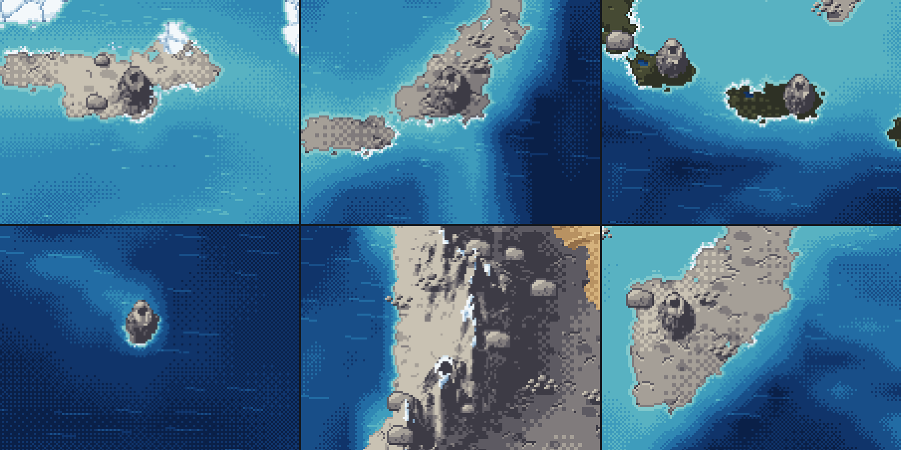
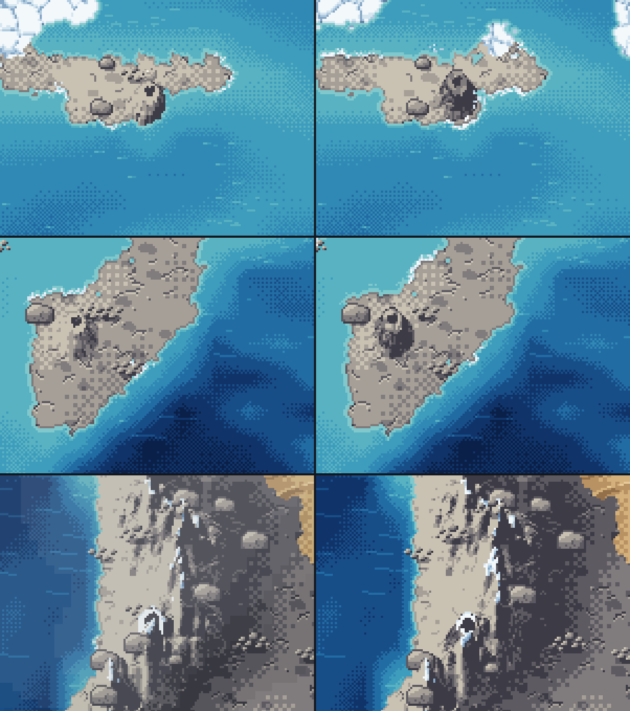
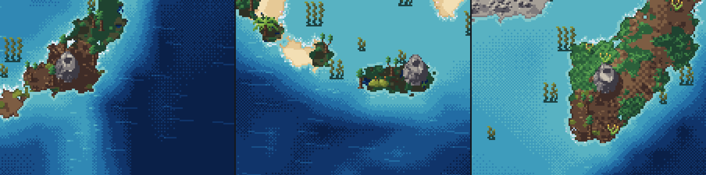
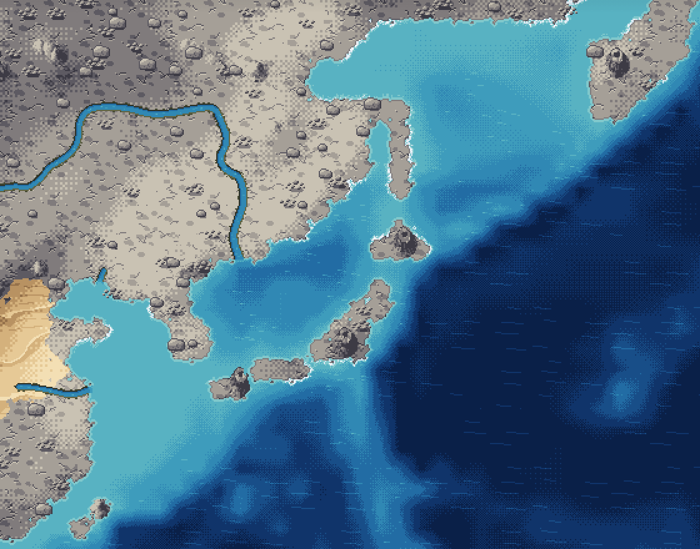
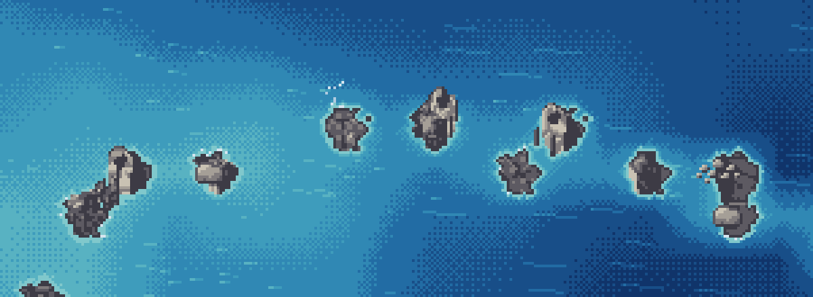
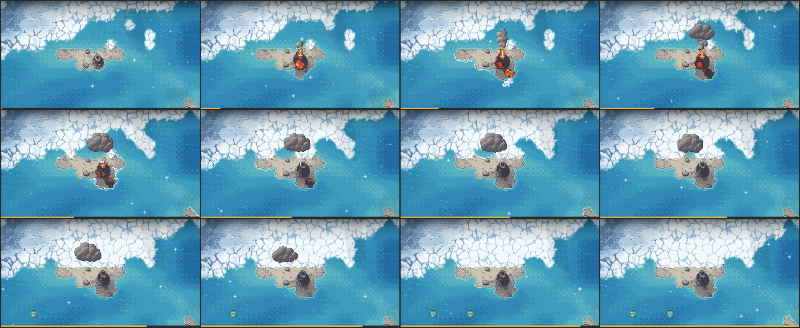
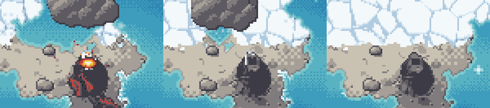

# Vulkane als Teil der Landschaft (Oktober 2026)

## Was sich geändert hat

Vulkane sind kein Symbol mehr, sondern Relief der Karte: ein Kegel mit Krater, gezeichnet wie die Gebirgskämme.

- **Natürliche Ausbrüche** laufen über `hazardSink` (`src/geo.ts`, gesetzt in `src/app.ts`) durch das `HazardSystem`. Der Schlot rückt auf den höchsten Landpunkt im Umkreis 2 (`EventSystem.coneTile`). Das 8×8-Symbol und der 9×9-Tafelberg entfallen.
- **Kegel** (`src/landridges.ts`, `src/landridgedraw.ts`): Höhe H = clamp(Kammhub + 10, 20, 28) px, Fußradius 2 + 0,5 · H, Krater 2 + H/12 px. Ab 15 % der Höhe kahl: ruhend Schutt, frisch Basalt; darunter der Boden der Kachel. Schnee über der Schneegrenze.
- **Auswahl** (`src/landfield.ts`, `volcanoes()`): jeder Schlot an Land; die höchste Landkachel im Umkreis 2 auf Inselbogen, Hotspot und Küstengebirge (dort ab Magma 0,3); neu auch jede Landkachel, deren Magma 0,45 über dem Planetenmittel liegt.
- **Ausbruch** (`src/fxvolcano.ts`): Kraterglut und Funken auf dem Krater. Schlote und Kegel über Magma ≥ 0,6 rauchen alle 20–40 s.

## Nachbesserung in dieser Runde

| Befund | Ursache | Änderung |
|---|---|---|
| Nach einem Meteoriten (oder einem anderen Umbau der Kämme) zeichnete die Karte nicht mehr; Kegel erschienen dann als flacher, heller „Findling“ ohne Krater | Der gemerkte Hub eines Chunks (`RISE_CACHE`) war nur nach der Form der Kämme geschlüsselt. Nach einem Neuaufbau mit anderer Nummerierung kamen alte Segment-Nummern zurück, `lift()` warf bei `rockKey[s]` = undefined | Die Segment-Nummer geht in den Schlüssel ein (`riseKey`); Texturen werden sicher nachgeschlagen, ein fehlender Schlüssel fällt auf Fels zurück (`groundTex`). Test: `landrender.test.js` „a meteor on a slope …“ (vorher rot, jetzt grün) |
| Kegel auf hellem Fels kaum zu sehen (Island, Kamtschatka), im Wald als heller Buckel | Fels-Kegel auf Fels-Boden, Lichtseite noch heller; im Wald grüne Flanken und helle alpine Matte | Ruhender Kegel aus Schutt statt Fels, kahl ab 15 % der Höhe, keine Matte. Ganzer Kegel eine Stufe dunkler, Lichtseite höchstens eine Stufe heller, Umrisslinie zwei Stufen dunkler (`landridgedraw.ts`, `CONE_DARKEN`, `CONE_LIGHT_MAX`, `CONE_OUTLINE_SHADE`) |
| Kegel wirkten wie Scheiben | Fuß 2 + 0,7 · H: Die Spitze stand in der 3/4-Ansicht nur ~4 px über dem hinteren Fuß | Fuß 2 + 0,5 · H, Mindesthöhe 16 → 20 px, Hub + 8 → + 10 |
| Küstenkegel als Wand abgeschnitten (Island) | Wasser setzt den Hub auf 0 | Kegel rückt bis 4 px vom Meer weg ins Land (`coneCentre`) |
| In den Anden kein Kegel erkennbar | Kammpunkte neben dem Kegel so hoch wie er; ein Kammpunkt auf der Kegelkachel füllte den Krater | Kamm auf der Kegelkachel auf 0 (`CONE_SADDLE`), eine Kachel daneben auf 75 % der Kegelhöhe (`CONE_SHOULDER`) |
| Findlinge und Bäume auf den Flanken, Wald verdeckt kleine Kegel | Objekte prüften nur die Baum- und Felsgrenze, Findlinge gar nicht | Auf dem Kegel steht nichts (`landObjectAboveLine`). Auf seiner Kachel und davor/dahinter nur junge Bäume, keine Findlinge (`landobjects.ts`) |
| Kein Kegel auf Hawaii | Epoche „Heute“ typt Hotspots nicht als Gürtel | Hotspot-Regel über das Magma (siehe oben); Hawaii, Island, Galápagos bekommen Kegel |

Gezählt (Tick 50 bzw. 1): „Heute“ (12345) 24 → 30 Kegel. Junge Erde (12345) 41 und Zufallsplaneten (12345, 777, 2718: 79, 58, 61) unverändert.

Kein Kegel am Erebus: Die Ross-Insel ist kleiner als eine Kachel, die Kachel unter dem Magma-Maximum (246, 119) ist Meer. Das ist eine Grenze der Kartenauflösung.

Die graue, kantige Fläche über dem Nordpazifik (Zoom 16, Kachel 247/30) kommt nicht vom Vulkan: Es ist die Wolkendecke mit ihrem Schatten (`ambient.ts`, Ebene „Wolken“; der Schatten hat nur eine Deckstufe, daher die harte Kante). Mit ausgeschalteten Wolken verschwindet sie.

## Aktive Vulkane: Kīlauea und Ätna

- Die Epoche „Heute“ setzt die beiden aktivsten Vulkane der Erde auf ihre Gipfelkrater (`ACTIVE_VOLCANOES` in
  `src/earthtoday.ts`): Kīlauea 19,421° N 155,287° W → Kachel 17/50, Ätna 37,748° N 14,999° O → Kachel 138/37.
- Ihre Kachel bekommt den Krustentyp `UpliftKind.ActiveVolcano` (`src/tectonics.ts`). Er wird gespeichert, reist
  mit der Platte und wird von keiner Hebung überschrieben. Dazu eine ausgleichende Hebung wie ein aktiver Gürtel,
  damit der Vulkan nicht abgetragen wird (gemessen 1.000 Ticks: Kīlauea 0,27 → 0,30, Ätna 0,10 → 0,12).
- Kegel: Ein aktiver Vulkan ist immer ein frischer Basaltkegel, wie ein junger Schlot; Gürtelkegel halten Abstand
  (`landfield.ts`). Vorher hatte der Ätna keinen Kegel: Sizilien lag knapp unter der Hotspot-Schwelle (Magma 0,66
  gegen 0,67), und Kalabrien ist höher.
- Effekt (`fxvolcano.ts`): Im Krater glüht ständig der Lavasee (`crater_glow`), etwa jede Sekunde fliegt ein Funke,
  und alle 0,45 s steigt ein kleines Rauchwölkchen auf, das mit dem Wind treibt. Mit „Effekte reduzieren“: stehende
  Glut, kein Funkenflug, Rauch nur alle 20–40 s wie bei anderen heißen Kegeln.

## Bilder

Aufgenommen mit Headless Chrome über `_preview.js` (`?seed=12345&epoch=today&ticks=50&zoom=32&x=…&y=…`, Wolken aus), Ausschnitte ×2.

| | |
|---|---|
|  | Epoche „Heute“, Tick 50, Zoom 32: Island (115/18), Fuji (226/38), Java (206/69); Hawaii (17/50), Anden (79/80), Kamtschatka (242/24). |
|  | Links vorher, rechts nachher: Island, Kamtschatka, Anden. |
|  | Tick 3000 mit Wald (Leben-Ebene aus): Fuji, Java, Kamtschatka. Kahle Schuttkegel mit Krater, kein Baum und kein Findling auf den Flanken. |
|  | Zoom 16: Japan, Philippinen, Kamtschatka-Süd – kleine dunkle Kegel. |
|  | Junge Erde, Tick 1: Inselbogen mit Kegeln, kein Grün. Graue Wölkchen über heißen Kegeln sind der Rauch aus `fxvolcano.ts`. |
|  | `node tools/fx-record.js --kind volcano --epoch today --x 115 --y 18 --zoom 32 --ticks 50 --frames 120`: Säule, Lava, Asche, danach frischer Basaltkegel. Kein Stempel. |
|  | Ausschnitt ×2: glühender Krater mit Funken, nach dem Ausbruch der dunkle Basaltkegel mit Krater. |

## Getestet

- Eigenes Bundle (`npx tsc … --outFile <scratch>/final.js`, `SE_BUNDLE`): `landrender`, `landscape`, `altitude`, `terrain`, `hazards`, `hazard-chain`, `fxatlas`, `tectonics`, `sim` – alle grün. `hazards` scheitert am Zeit-Test (5 ms/Tick), wenn Chrome parallel läuft; allein grün.
- Neuer Test `landrender.test.js` „ranges: a meteor on a slope renumbers the segments; kept rises never recall stale ids“: mit dem alten Bundle rot (TypeError in `lift()`), jetzt grün.
- Zusammensetzen der ganzen Karte (128 Chunks, „Heute“, Tick 50, Node): vorher 299–315 ms, nachher 292–307 ms; `refresh` 57–62 ms unverändert.
- Headless Chrome: Zoom 32 an sieben Orten (Erebus ohne Kegel, siehe oben), Zoom 16 über Japan und Südamerika, junge Erde, Tick 3000 mit Wald, Ausbruch auf Island.

## Einschränkungen

- Hohe Bäume unmittelbar seitlich eines kleinen Kegels können seinen Fuß noch verdecken; nur Kachel, Vorder- und Hinterkachel tragen junge Bäume.
- Die Flanken ruhender Kegel wachsen nicht mehr zu (anders als `ereignisse-spec.md` §3.1 „Seine Flanken wachsen zu“): Lesbarkeit ging vor.
- Kegel mitten in Gebirgen sind kleiner als die Kämme ringsum erlaubt (Obergrenze 28 px für alles Relief); sie lesen sich über Umriss, Krater und Schneekranz.
- Rauch über Magma ≥ 0,6 ist absolut: Auf der jungen Erde (Mittel 0,69) raucht fast jeder Kegel.
- Nur Headless Chrome geprüft.
