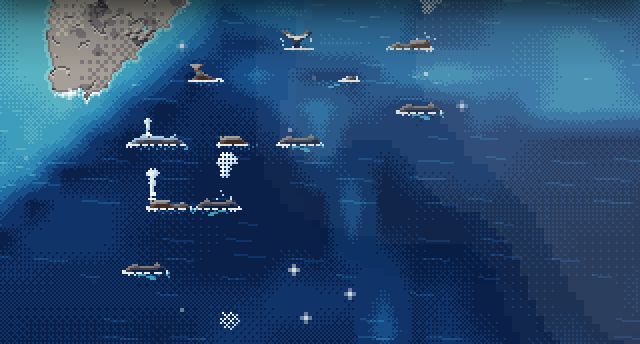
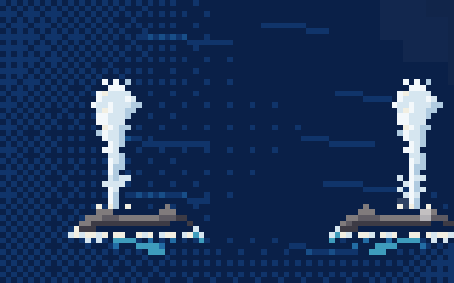
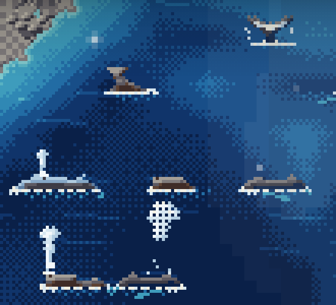
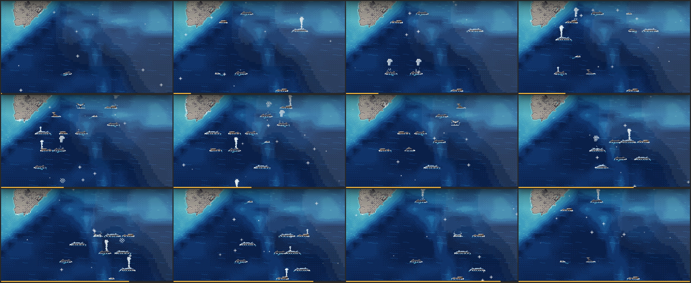
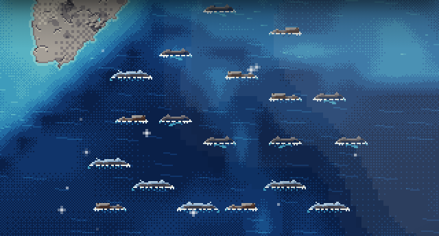
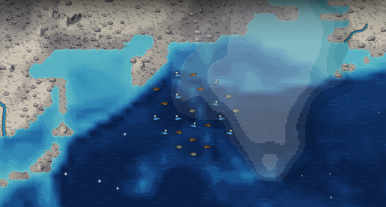

# Pixel-Wale auf dem offenen Meer (Oktober 2026)

## Was gebaut wurde

Ab 16 px pro Kachel tauchen auf dem offenen Meer Wale als Pixel-Sprites auf: Sie steigen auf, schwimmen ein paar Sekunden, blasen ein- oder zweimal und tauchen mit der Fluke ab. Weiter herausgezoomt bleibt das bisherige SVG-Symbol.

- Art: `tools/fx/fauna.js` und die Katalogeinträge `whale_great` (Blauwal, 32 × 16), `whale_baleen` (Buckelwal, 24 × 16), `whale_sperm` (Pottwal, 24 × 16), je 8 Frames nach Osten und 8 nach Westen, dazu `whale_blow` (Blas, 16 × 24, 8 Frames). Alles liegt im Effekt-Atlas (`src/fxatlas.ts`).
- Darstellung: `src/whalelayer.ts` (`WhaleLayer`, `whaleSprite`, `whalePhase`), eingehängt in `src/render.ts` (Ebene „Leben“) und `src/herds.ts` (das Herdensymbol wird übersprungen, wo ein Pixel-Wal schwimmt).

## Wie es funktioniert

- Die Wale reiten auf den Herdenmarkern der Wale (`Life.Cetacean`), nur auf den Stufen 4 (Bartenwal), 5 (Pottwal) und 7 (Großwal) und nie bei Biom-Spezialisten (Narwal). Delfine und frühe Stufen behalten ihr Symbol.
- Ein Wal erscheint nur, wenn seine Kachel und die Nachbarkacheln im Osten und Westen Wasser sind. So liegt der bis zu 1,5 Kacheln breite Sprite nie auf Land oder Küste.
- Jeder Wal hat einen eigenen Zyklus von 14 bis 24 s: 0,5 s Auftauchen, 5 s Schwimmen (driftet 3 Art-Pixel/s in Blickrichtung), Blas nach 0,8 s und in der Hälfte der Zyklen ein zweiter nach 3 s, 0,8 s Abtauchen mit Fluke, danach unter Wasser. Neue Wale beginnen unter Wasser, damit sie auftauchen statt aufzuploppen.
- Kachel und Blickrichtung übernimmt der Wal nur, während er unter Wasser ist. Die Schritte der Herde passieren also unsichtbar, und ein Wal dreht sich nie an der Oberfläche um.
- Der Blas kommt aus dem Blasloch (`mouth` im Katalog), bei Westblick gespiegelt, und versprüht dazu die Gischttropfen der Brandung (`sprayDrops`).
- „Effekte reduzieren“ (und `prefers-reduced-motion`): ein ruhender Wal im Schwimm-Frame, ohne Blas, ohne Abtauchen.
- Solange der Effekt-Atlas nicht geladen ist (oder nicht dekodiert werden konnte), bleibt das SVG-Symbol stehen.

## Bilder

Aufgenommen mit `node tools/fx-record.js --whales --epoch today --ticks 50 --speed 0 --zoom 32` (neuer Modus: setzt im Umkreis von 6 Kacheln um eine Hochsee-Stelle Wale der Stufen 4/5/7 mit Dichte 0,6).

| | |
|---|---|
|  | Zoom 32: Wale schwimmen, blasen und tauchen ab; Flukenframes oben. |
|  | Ausschnitt ×4: links ein Wal nach Westen, rechts nach Osten. Der Blas steigt jeweils aus dem vorderen Rücken. |
|  | Ausschnitt ×3: Fluke beim Abtauchen (oben), Blas eines Pottwals und eines Buckelwals. |
|  | 12 Bilder über 20 s: Wale tauchen versetzt auf und ab. |
|  | „Effekte reduzieren“: alle Wale ruhen sichtbar an der Oberfläche. |
|  | Zoom 12: unter 16 px pro Kachel die bisherigen SVG-Symbole. |

## Getestet

- `tests/whales.test.js` (Stufen → Sprite, Zyklus mit ein bis zwei Blasen, Abtauchen, unsichtbare Phase), `tests/fxatlas.test.js`, `tests/landrender.test.js`, `tests/sim.test.js` gegen ein eigenes Bundle: alle grün.
- Headless Chrome (Epoche „Heute“, Kachel 247/30): Zoom 32 bei Tempo 0 (200 Bilder) und Tempo 3 (60 Bilder), Zoom 32 mit „Effekte reduzieren“, Zoom 12. Geprüft: Wale nur auf Wasser, Blickrichtung = Driftrichtung, Blas am Blasloch in beiden Richtungen, Fluke-Frames, kein SVG-Symbol unter oder über einem Pixel-Wal, kein Flackern zwischen den Bildern.
- Behoben: `WhaleLayer.claims` gab schon vor dem Laden des Effekt-Atlas `true` zurück; bis dahin (oder für immer, wenn der Atlas nicht dekodiert) war an diesen Stellen weder Wal noch Symbol zu sehen.

## Einschränkungen

- Nur in headless Chrome geprüft, nicht auf echten Mobilgeräten oder in anderen Browsern.
- Zwei Wale auf Markern im Mindestabstand (2 Kacheln) können sich beim Driften leicht überlappen.
- Zieht die Herde während des Schwimmens auf eine Küstenkachel, verschwindet der Wal sofort und das Symbol erscheint dort.
- Wale werden nicht wie die Herdensymbole bei voller Ansicht ausgedünnt; bei ≥ 16 px pro Kachel ist der Ausschnitt dafür klein genug.
